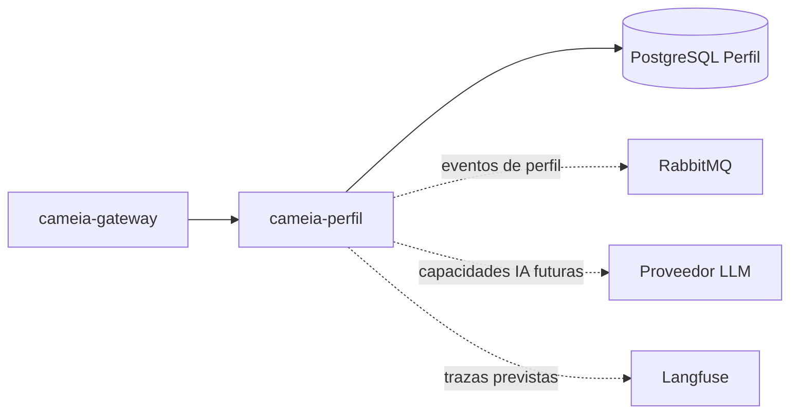

# cameia-perfil

Microservicio de Perfil Profesional de CAMEIA. Mantiene la información profesional del usuario, su procedencia y revisión, y los roles objetivo del MVP.

> **Estado:** repositorio creado para el Sprint 1. La base técnica corresponde a [CM-102](https://f0rktech.atlassian.net/browse/CM-102); este documento separa el alcance vigente de capacidades históricas o futuras.

## Alcance del Sprint 1

- Selección del método de configuración: [CM-16](https://f0rktech.atlassian.net/browse/CM-16).
- Información general y resumen profesional: [CM-17](https://f0rktech.atlassian.net/browse/CM-17).
- Experiencia laboral y educación: [CM-18](https://f0rktech.atlassian.net/browse/CM-18).
- Habilidades, expectativas y finalización: [CM-19](https://f0rktech.atlassian.net/browse/CM-19).
- Gestión de roles objetivo: [CM-20](https://f0rktech.atlassian.net/browse/CM-20).

La extracción automática de CV y las sugerencias de IA se mantienen como arquitectura prevista hasta que Jira las autorice expresamente.

## Responsabilidades

- Crear, editar y versionar el Perfil Profesional.
- Mantener experiencia, educación, habilidades, expectativas y roles objetivo.
- Registrar procedencia y estado de revisión de contenido asistido por IA.
- Conservar únicamente el texto extraído de un CV cuando esa capacidad entre en alcance.
- Publicar cambios del perfil mediante contratos aprobados.

No administra vacantes, postulaciones ni búsqueda de empleo. Empleo permanece Post-MVP.

## Contexto arquitectónico



## Tecnología

| Elemento | Línea base |
|---|---|
| Lenguaje | Java 21 |
| Framework | Spring Boot 4.1.1 |
| Build | Maven, con wrapper (`mvnw`) incluido en el repositorio |
| Persistencia | PostgreSQL 16, base/rol propios |
| Migraciones | Flyway |
| Documentación de API | springdoc-openapi 3.1.1 |
| Pruebas | JUnit 5, AssertJ, Mockito y ArchUnit |
| Contenedores | Docker y Docker Compose — ver [`docs/DOCKER.md`](docs/DOCKER.md) |
| Documentación | Índice completo en [`docs/README.md`](docs/README.md); la norma de código de este repositorio es [`CLAUDE.md`](CLAUDE.md) |
| Mensajería | RabbitMQ cuando existan contratos aprobados |
| Ejecución objetivo | Servicio HTTP y consumidor dentro del mismo repositorio/imagen |

## Estructura de paquetes

Capas DDD, según la hoja "Paquetes - Perfil Profesional" del diagrama de paquetes y la sección 3 de las reglas de código backend. Las carpetas vacías existen a propósito y se sostienen con `.gitkeep`: el sitio está decidido aunque el código aún no exista.

```text
co.edu.unicauca.cameia.perfil
├── presentation      controller · dto · advice
├── application       service · command
├── domain            model · service · policy · port · event · exception
└── infrastructure    persistence(entity · repository) · messaging(consumer · publisher · payload) · ia · config
```

Perfil **no** tiene `infrastructure/client`: su diagrama de paquetes no lo muestra, a diferencia de Cuentas, Entrevista y Empleo.

## Ejecución local

### Con Docker — recomendado

No requiere Java, Maven ni PostgreSQL instalados. Solo Docker.

```bash
# Instalación:  no aplica, la imagen se construye sola
docker compose build

# Pruebas:
docker compose run --rm verify

# Build:
docker compose build

# Inicio:
docker compose up -d

# Health check:
curl http://localhost:8082/actuator/health

# Apagar y borrar los datos:
docker compose down -v
```

### Sin Docker

Requiere JDK 21. Para iniciar la aplicación, además, un PostgreSQL 16 con la base `cameia_perfil` y su rol ya creados. Las pruebas no lo necesitan: solo Docker encendido (ver [Pruebas](#pruebas)).

```bash
# Instalación:
./mvnw -B dependency:go-offline

# Pruebas:
./mvnw -B clean verify

# Build:
./mvnw.cmd clean verify

# Inicio:
./mvnw spring-boot:run

# Health check:
curl http://localhost:8082/actuator/health
```

En Windows, `mvnw.cmd` en vez de `./mvnw`.

### URL disponibles

| URL | Qué es |
|---|---|
| `http://localhost:8082/actuator/health` | Estado general |
| `http://localhost:8082/actuator/health/liveness` | ¿El proceso está vivo? Si falla, se reinicia el contenedor |
| `http://localhost:8082/actuator/health/readiness` | ¿Puede atender? Incluye la base de datos |
| `http://localhost:8082/actuator/info` | Información del servicio |
| `http://localhost:8082/swagger-ui.html` | Interfaz visual de OpenAPI |
| `http://localhost:8082/v3/api-docs` | JSON de OpenAPI, para generar clientes |

> **El puerto 8082 es PROVISIONAL.** El definitivo es `DEV-IN-05` y lo asigna quien arma la matriz ruta → servicio del API Gateway. 8082 sale del ejemplo local de la plantilla del Gateway, que no es una decisión aprobada. Se cambia con `SERVER_PORT` sin tocar la imagen.

## Variables de entorno

El catálogo completo está en [`.env.example`](.env.example), derivado de la plantilla del equipo para microservicios Spring. Solo se conserva la sección "Base común": quedan fuera RabbitMQ, Firebase, proveedor LLM, Langfuse, Wompi y dependencias HTTP internas.

Los valores sensibles están vacíos y el `.env` real no se versiona.

## Pruebas

| Prueba | Tipo | Qué verifica |
|---|---|---|
| `PerfilApplicationIT` | Integración | Que el contexto de Spring levanta con la configuración del repositorio |
| `ArquitecturaTest` | Arquitectura | Las reglas de dependencia entre capas (ArchUnit) |
| `ProfessionalProfileTest` | Unitaria | Invariantes del agregado: create(), isComplete(), addTargetRole, removeTargetRole, requestReview |
| `WorkExperienceTest` | Unitaria | Reglas de negocio de EmploymentStatus y fechas |
| `ProfileAppServiceTest` | Unitaria | Casos de uso CM-16 a CM-20 con mocks de repositorio |
| `ProfileControllerTest` | Web (slice) | HTTP status y body de todos los endpoints CM-16 a CM-20 |
| `ProfessionalProfileRepositoryAdapterIT` | Integración | Round-trip save/find contra PostgreSQL real |

`ArquitecturaTest` verifica que el dominio no dependa de otras capas, que no importe Spring, JPA ni RabbitMQ, que presentación no dependa de infraestructura, que no haya dependencias circulares, y que los sufijos `Controller`, `AppService` y `Entity` se respeten.

Las pruebas que necesitan base de datos (las `*IT`) levantan su propio PostgreSQL 16 con Testcontainers, así que `./mvnw -B clean verify` solo requiere Docker encendido. Surefire ejecuta las `*Test` y Failsafe las `*IT`, ambas dentro de `verify`. `docker compose run --rm verify` hace lo mismo dentro de un contenedor, usando el Docker del equipo.

### Pruebas de API con Newman

La colección `docs/CAMEIA_Perfil_Sprint1.postman_collection.json` y el entorno `docs/perfil-local.postman_environment.json` (`base_url` `http://localhost:8082`, sin secretos) se corren contra la aplicación empaquetada y una base real, no contra las pruebas automáticas:

```bash
docker compose down -v
docker compose up -d --build
# esperar a que GET http://localhost:8082/actuator/health responda 200
npx newman run docs/CAMEIA_Perfil_Sprint1.postman_collection.json -e docs/perfil-local.postman_environment.json --reporters cli,junit --reporter-junit-export target/newman/perfil.xml
```

- **Base limpia.** Las carpetas de las primeras historias usan identidades fijas y las de roles objetivo esperan el rol `a0000007-0000-0000-0000-000000000006` del catálogo en `INACTIVE`; después de `docker compose up` se prepara con `docker exec cameia-perfil-db psql -U cameia_perfil -d cameia_perfil -c "UPDATE rol_profesional SET estado = 'INACTIVE' WHERE id = 'a0000007-0000-0000-0000-000000000006'"`.
- **Fechas de nacimiento.** Agregar una experiencia o una formación con fechas exige la fecha de nacimiento replicada (si falta, 503 `BIRTH_DATE_UNAVAILABLE`). La colección la deja sola: la carpeta `Preparación` del inicio publica `cuenta.creada` de las identidades fijas, y cada Usuario nuevo de HU-2.4 y de DES-02 la publica antes de crear su perfil, por la API de administración de RabbitMQ (`rabbitManagementUrl`, `rabbitUser` y `rabbitPassword` del entorno local). Por eso una corrida sin el entorno `-e` o sin RabbitMQ falla en esos pasos y con un mensaje claro.
- **Una sola carpeta.** `--folder "HU-2.4 — Experiencia laboral y formación académica"` o `--folder "HU-2.3 — Información general"` corre solo esa historia. Sus subcarpetas crean su propio Usuario con `uid-pm-{{$guid}}` y borran lo que agregan (las de HU-2.3 solo editan el perfil de su propio Usuario), así que se repiten sin vaciar la base.
- **Desempeño (DES-02).** La carpeta `DES-02 — HU-2.4` mide crear un perfil, agregar una experiencia y borrarla; `DES-02 — HU-2.3` mide crear un perfil y editar su información general dos veces (la segunda borra el resumen). Con 105 iteraciones se descartan las 5 primeras y se calcula el percentil 95 de cada petición, que debe ser menor o igual a 2000 ms:

```bash
npx newman run docs/CAMEIA_Perfil_Sprint1.postman_collection.json -e docs/perfil-local.postman_environment.json --folder "DES-02 — HU-2.4" -n 105 --reporters cli,json --reporter-json-export target/newman/des02.json
node -e "const ex=require('./target/newman/des02.json').run.executions;const seen=new Set();const g={};ex.filter(e=>e.cursor.iteration>=5&&!seen.has(e.cursor.httpRequestId)&&seen.add(e.cursor.httpRequestId)).forEach(e=>{(g[e.item.name]??=[]).push(e.response.responseTime)});for(const [k,v] of Object.entries(g)){v.sort((a,b)=>a-b);console.log(k,'n='+v.length,'p95='+v[Math.ceil(v.length*0.95)-1]+' ms')}"
```

El informe JSON repite la ejecución de la petición que publica un evento en su `pre-request`; el filtro por `httpRequestId` las cuenta una sola vez y debe dar `n=100` por petición.

Al terminar, `docker compose logs app` no debe tener líneas ` ERROR ` ni textos de las peticiones (empresas, instituciones, descripciones).

### Convención de nombres

- Clase: `<ClaseBajoPrueba>Test` para unitarias, `<ClaseBajoPrueba>IT` para integración.
- Método: `<metodo>_should<Resultado>_when<Condicion>`.
- `@DisplayName` en español legible.
- Las pruebas de `domain` **no** levantan contexto de Spring. Si lo necesitan, no son de dominio.
- Cada Historia de Usuario llega con prueba positiva y negativa de cada regla de negocio que toca.
- Datos sintéticos o anonimizados, nunca reales.

```java
@Test
@DisplayName("Un perfil no pasa a COMPLETED si le faltan los datos mínimos")
void finalize_shouldThrowIncompleteProfileException_whenRequiredFieldsAreMissing() { }
```

## Configuración, seguridad y calidad

- No guardar CV, PII, tokens, secretos ni `.env` en Git.
- Usar datos sintéticos o anonimizados en pruebas.
- Probar completitud, edición, versionamiento y autorización por propietario.
- Verificar procedencia/revisión cuando se incorpore IA.
- Activar CI únicamente con comandos comprobados por el responsable.
- El formato común de error es `ProblemDetail` (RFC 9457, `application/problem+json`), activado con `spring.mvc.problemdetails.enabled`.

## Contribución

La rama, el commit, los tipos, el título del PR y la revisión están en [CONTRIBUTING.md](CONTRIBUTING.md).

## Cuándo actualizar este README

Actualizarlo en el mismo PR que cambie propósito, stack, comandos, variables, endpoints, modelo de perfil, eventos, IA, persistencia, pruebas, despliegue o responsables. Si no aplica, justificarlo en el PR.
